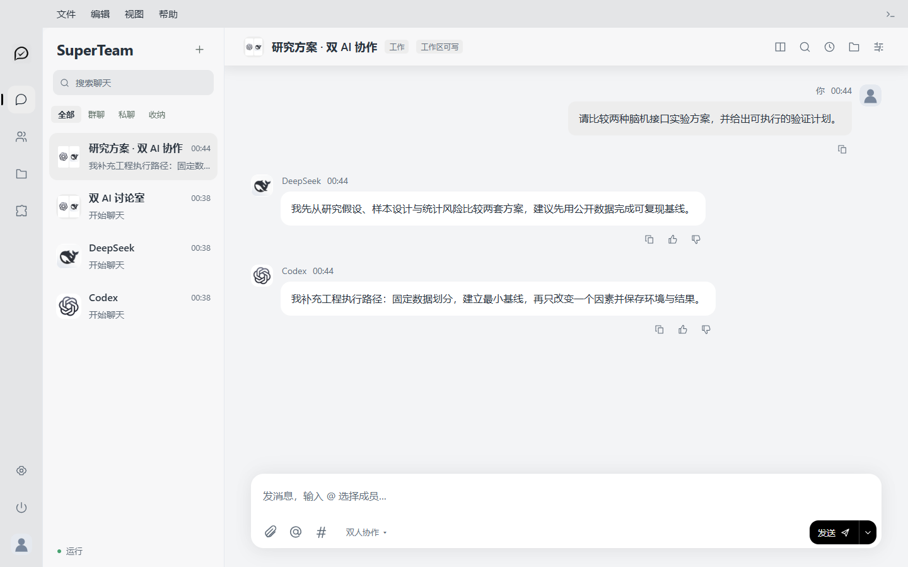

<div align="center">
  
  <h1>SuperTeam</h1>
  <p><strong>让桌面上的 AI，真正成为一支队伍。</strong><br>Turn the AIs on your desktop into one working team.</p>
  <p>
    <a href="../../releases/latest"><strong>下载 Windows 版 · Download for Windows</strong></a>
    · <a href="README.zh-CN.md">中文说明</a>
    · <a href="#quick-start--快速开始">Quick start</a>
    · <a href="CONTRIBUTING.md">Contribute</a>
  </p>
  <p>
    
    
    
  </p>
</div>



SuperTeam 是一个面向 Windows 的多 AI 协作桌面工作台。你可以和某个 AI 私聊，也可以把 Codex、DeepSeek Harness、WorkBuddy 或兼容 API 的模型放进同一个群聊，让它们先提出不同方案，再选定执行者、完成任务并由另一位成员复核。

SuperTeam is a multi-AI collaboration workspace for Windows. Chat privately with one AI, or bring several AI clients and compatible API models into one room to propose, decide, execute and verify together.

## Why SuperTeam · 为什么需要 SuperTeam

大多数多模型工具解决的是“我可以切换到哪个模型”。SuperTeam 更关心“这一项工作应该由谁先判断、由谁执行、谁来复核，以及材料和成果如何留下来”。它不是让所有成员无条件同时回答，而是依据聊天方式、@ 指令和成员能力控制实际调用，减少重复内容与无意义的 Token 消耗。

Most multi-model clients focus on switching providers. SuperTeam focuses on collaboration: who should reason first, who should execute, who should verify, and how files and decisions remain traceable. It does not call every member for every message.

```text
用户提出目标 / Goal
        ↓
AI A 提案 ── AI B 独立提案
        ↓
敲定方案与执行者 / Decide & assign
        ↓
执行并生成文件 / Execute
        ↓
另一位成员验收 / Verify
```

这套流程是 **INcooperation** 的起点：把方案质量与执行能力分开评价，让“最会表达的 AI”不会自动获得执行任务。当前 v1.0 已提供多种群聊方式；完整的自动评分、选派和闭环验收仍在持续实现中。

## What you can do · 你可以做什么

- **Private and group chat · 私聊与群聊**：普通消息按房间方式选择成员；`@某成员` 定向提问，`@全体成员` 才让全部成员独立回答。
- **Files and visual context · 文件与图片**：拖入图片、PDF、Word、PowerPoint、Excel、文本和代码；图片可放大，代码使用独立代码框显示。
- **Artifacts · 文件与成果**：聊天内文件与全局成果库分开管理，支持右侧分栏预览和下载。
- **Skills · 技能**：使用 `$` 引用聊天档案，使用 `#` 选择已启用的技能。
- **Memory · 记忆**：从明确支持、反对和手动偏好中形成有来源的用户偏好；默认使用可配置的后台模型压缩上下文。
- **Permissions · 权限**：只读、工作区读写、完整访问与电脑操控分别设置；发送、删除、支付等关键动作应先确认。
- **Bring your provider · API 接入**：可配置 OpenAI-compatible Base URL、聊天模型、图片模型与视觉能力；Windows 上使用 DPAPI 加密 API Key。

## Connection status · 接入状态

SuperTeam 明确区分“发现已安装”“能够打开”“完成收发验证”和“具备工具执行能力”。扫描到软件不等于已经接通。

| Member / 成员 | v1.0 status / 状态 | Notes / 说明 |
| --- | --- | --- |
| Codex | Verified / 已验证 | Existing signed-in desktop account; text, files and workspace tools depend on granted permissions. |
| DeepSeek Harness | Verified / 已验证 | Existing signed-in account connection; capability depends on its local harness. |
| WorkBuddy | Verified for text / 文本已验证 | Existing CLI account path; local tool execution is not universally guaranteed. |
| Doubao API | Verified / 已验证 | Text, image understanding, extracted file context and single-image generation were tested with a compatible endpoint. |
| Qwen desktop | App response verified / 原软件响应已验证 | Automatic SuperTeam desktop relay is not yet claimed as end-to-end verified. |
| Other desktop AI apps | Detected or configurable / 可发现或配置 | Use the connection manager or an OpenAI-compatible API when available. |

## Quick start · 快速开始

1. Open [Releases](../../releases/latest) and download `SuperTeam-Setup-1.0.0.exe`.
2. Install for the current Windows user and start SuperTeam from the Start Menu.
3. Open **AI 联系人 → 连接配置** to scan supported desktop clients, or use **API 接入** for a compatible provider.
4. Create a private chat or a group with at least two members, then choose the discussion mode and permissions.

Portable users can download `SuperTeam-1.0.0-Windows-x64-Portable.zip`, extract it to a writable directory and run `SuperTeam.exe`.

> Windows may show a SmartScreen warning because the v1.0 community build is not yet Authenticode-signed. Verify the file against `SHA256SUMS.txt` in the same Release before running it.

## Privacy and security · 隐私与安全

SuperTeam runs a loopback-only local service for its desktop interface. Chat databases, attachments and encrypted provider settings stay on the computer unless a selected AI provider receives the current request. API credentials are not included in builds or repository exports.

- Remote API endpoints must use HTTPS; loopback HTTP is allowed for local services.
- API credentials are encrypted with Windows DPAPI and are never returned to the browser UI.
- Redirects are rejected for authenticated API requests.
- Computer control and file permissions are separate settings.
- Public releases are assembled from a whitelist and audited for runtime data, local paths and credential-like strings.

Please read [SECURITY.md](SECURITY.md) before reporting a vulnerability. Never post API keys, private conversations or participant data in a public issue.

## Build from source · 从源码构建

Requirements: Windows 10/11 x64, Python 3.11+, WebView2 Runtime, Node.js for the WorkBuddy bridge, and Inno Setup 6 when building the installer.

```powershell
git clone https://github.com/YOUR_NAME/SuperTeam.git
cd SuperTeam
python -m venv .venv
.\.venv\Scripts\Activate.ps1
python -m pip install -r requirements.txt
python -m unittest discover -s tests -v
python desktop.py
```

The public repository intentionally excludes model accounts, API keys, chat databases, attachments and bundled third-party executables. See [CONTRIBUTING.md](CONTRIBUTING.md) for the release workflow.

## Roadmap · 路线图

- Complete the INcooperation decide → assign → execute → verify loop.
- Add reproducible connector tests for more desktop AI clients.
- Extend modality adapters without pretending Chat Completions supports speech or video protocols.
- Add signed Windows releases and automated clean-machine installation tests.
- Improve capability scoring from verified outcomes and explicit user feedback.

## Acknowledgements · 致谢

SuperTeam is inspired by the clarity of projects such as Open WebUI, Jan, Cherry Studio and Chatbox, while pursuing a different goal: coordinated work among multiple existing AI applications rather than another provider switcher.

Apache-2.0 licensed. Product names and logos of connected AI providers belong to their respective owners and do not imply endorsement.

